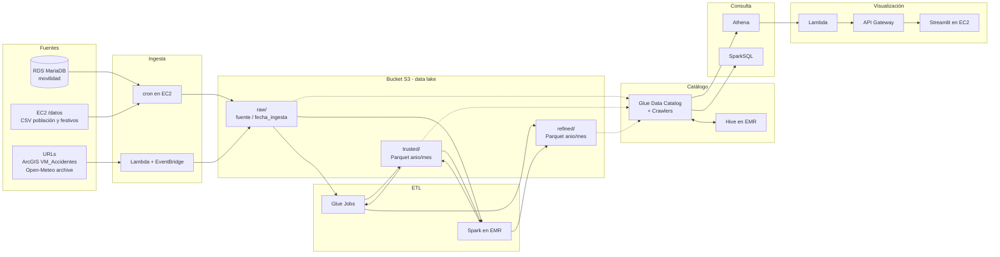

# Siniestralidad vial en Medellín y su relación con el clima

Proyecto 2 — Big Data (SI3007), Universidad EAFIT.

## Descripción del caso

Este proyecto construye un **data lake en AWS** para analizar la siniestralidad vial de Medellín entre 2019 y 2025 y su relación con las condiciones climáticas. Se integran siniestros viales (por fecha, hora, comuna, gravedad y clase de accidente) con el clima horario (precipitación, temperatura, etc.), la población por comuna y el calendario de festivos, para responder preguntas como:

- ¿Aumentan los siniestros en horas con lluvia?
- ¿Qué comunas tienen mayor tasa de siniestros por cada 100.000 habitantes?
- ¿Cómo cambia la siniestralidad en días festivos frente a días hábiles?

### Fuentes de datos

| Tipo | Fuente | Contenido |
|------|--------|-----------|
| Base de datos | RDS MariaDB (base `movilidad`) | Siniestros 2019–2022 y catálogo de comunas y barrios |
| Archivos | EC2, carpeta `/datos` | Población por comuna y festivos de Colombia 2019–2025 (CSV) |
| URL / API | ArcGIS "VM_Accidentes" (Alcaldía de Medellín) | Siniestros 2023–2025 |
| URL / API | Open-Meteo (API archive) | Clima horario de Medellín |

## Arquitectura



> Streamlit se expone directamente desde la EC2 (no detrás de API Gateway, porque usa websockets) y consume la API REST.

Bases del Glue Data Catalog: `siniestros_raw`, `siniestros_trusted`, `siniestros_refined`.
Más detalle de la arquitectura y convenciones en [CLAUDE.md](CLAUDE.md).

## Puntos del proyecto

| # | Punto | Carpeta |
|---|-------|---------|
| 1 | Caso de estudio | [punto1_caso_estudio/](punto1_caso_estudio/) |
| 2 | Fuentes de datos (RDS, EC2, URL) | [punto2_fuentes/](punto2_fuentes/) |
| 3 | Ingesta automática hacia raw | [punto3_ingesta/](punto3_ingesta/) |
| 4 | ETL raw → trusted → refined (Glue / EMR) | [punto4_etl/](punto4_etl/) |
| 5 | Catálogo (Glue Crawlers / Hive) | [punto5_catalogo/](punto5_catalogo/) |
| 6 | Consultas SQL (Athena, Hive, SparkSQL) | [punto6_sql/](punto6_sql/) |
| 7 | Análisis con PySpark | [punto7_pyspark/](punto7_pyspark/) |
| 8 | Visualización (gráficos, API, Streamlit) | [punto8_visualizacion/](punto8_visualizacion/) |

Infraestructura base: [infra/](infra/). Evidencias: [docs/evidencias/](docs/evidencias/).

## Requisitos previos

1. **AWS Academy Learner Lab** activo (botón *Start Lab*, indicador en verde). Región **us-east-1**. No se pueden crear roles IAM: se usa `LabRole` y `LabInstanceProfile`.
2. **AWS CLI v2** instalada (`aws --version` debe mostrar `aws-cli/2.x`).
3. **Python 3.11** y un entorno virtual:
   ```bash
   python -m venv .venv
   source .venv/bin/activate        # Windows (Git Bash): source .venv/Scripts/activate
   pip install -r requirements.txt
   ```
4. **Credenciales del Learner Lab** (cambian en cada sesión):
   1. En el Learner Lab, clic en **AWS Details** → **AWS CLI: Show**.
   2. Copiar el bloque completo (`[default]`, `aws_access_key_id`, `aws_secret_access_key`, `aws_session_token`).
   3. Pegarlo reemplazando el contenido de `~/.aws/credentials` (en Windows: `C:\Users\<usuario>\.aws\credentials`).
   4. Fijar la región: `aws configure set region us-east-1`.
   5. Comprobar: `aws sts get-caller-identity`.
5. **Archivo `.env`**: `cp .env.example .env` y completar `NOMBRE_BUCKET` y los datos de RDS. Nunca subir `.env` al repositorio.

## Infraestructura base

```bash
bash infra/verificar_entorno.sh    # revisa CLI, credenciales, región y roles
bash infra/crear_datalake.sh       # crea el bucket y las zonas (idempotente)
bash infra/destruir_datalake.sh    # vacía y borra el bucket (pide confirmación)
```
