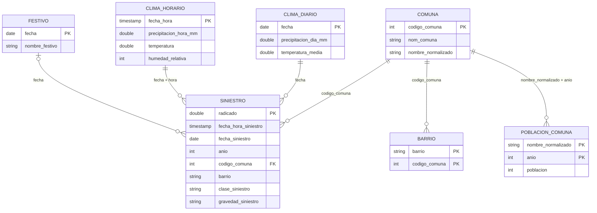

# Punto 1 — Caso de estudio

## Objetivo

Crear un caso de estudio donde se procesen datos almacenados en fuentes de datos Bases de Datos, Archivos y URL. Conseguir un conjunto de datos (típicamente datasets públicos), almacenar una parte en bases de datos como fuente, y plantear al menos 5 preguntas/hipótesis de negocio que se contestarán con estos datos.

_Fuente: [docs/enunciado.md](../docs/enunciado.md)._

## Caso de estudio

**Siniestralidad vial en Medellín y su relación con el clima (2019–2025).**

La Secretaría de Movilidad de Medellín publica cada siniestro vial (choque, atropello, volcamiento, etc.) con fecha, hora, gravedad, comuna, barrio y coordenadas. Por su parte, Open-Meteo publica el clima histórico hora a hora. Este caso integra ambas fuentes con la población proyectada por comuna y el calendario de festivos para responder:

- **¿Influye la lluvia** en la cantidad y la gravedad de los siniestros?
- **¿Cuándo y dónde** se concentran los siniestros (hora, día de la semana, festivos, comuna, barrio)?
- **¿Qué comunas tienen más riesgo** relativo a su población?

El objetivo analítico es producir indicadores descriptivos (conteos, promedios por día, proporciones y tasas por 10.000 habitantes) que sirvan para priorizar campañas de seguridad vial y operativos de tránsito en días de lluvia y festivos.

## Fuentes de datos

| # | Fuente | Tipo | Origen | Periodo | Filas aprox. | Destino en la arquitectura |
|---|--------|------|--------|---------|--------------|----------------------------|
| a1 | Siniestros viales 2019–2022 | Base de datos | Capa ArcGIS [VM_Accidentes/0](https://www.medellin.gov.co/servidormapas/rest/services/transporte/VM_Accidentes/MapServer/0) filtrada `anio <= 2022`, cargada en **RDS MariaDB**, base `movilidad` (simula el sistema transaccional) | 2019–2022 | 157.603 | cron EC2 → `raw/rds_siniestros/` |
| a2 | Catálogo de comunas y barrios | Base de datos | Derivado de `num_comuna`, `nom_comuna` y `barrio` de la misma capa + nombres de la capa de población; tablas en RDS `movilidad` | — | 21 comunas/corregimientos; ~445 combinaciones barrio–comuna | cron EC2 → `raw/rds_comunas_barrios/` |
| b1 | Población por comuna | Archivo | Capa ArcGIS [VC_Distribucion_Poblacional/1](https://www.medellin.gov.co/servidormapas/rest/services/mapas_nacionales/VC_Distribucion_Poblacional/MapServer/1) exportada a CSV en **EC2 `/datos`** | 2018–2030 (proyección) | 21 | cron EC2 → `raw/ec2_poblacion/` |
| b2 | Festivos de Colombia | Archivo | CSV en **EC2 `/datos`** (calendario oficial de festivos de Colombia) | 2019–2025 | ~126 (≈18 por año) | cron EC2 → `raw/ec2_festivos/` |
| c1 | Siniestros viales 2023–2025 | URL | Capa ArcGIS [VM_Accidentes/0](https://www.medellin.gov.co/servidormapas/rest/services/transporte/VM_Accidentes/MapServer/0) con `where=anio >= 2023`, paginada de 2.000 en 2.000 (`resultOffset`) | 2023–2025 | 78.217 | Lambda + EventBridge → `raw/url_arcgis_accidentes/` |
| c2 | Clima horario y diario | URL | [API archive de Open-Meteo](https://archive-api.open-meteo.com/v1/archive) (lat 6.2442, lon -75.5812, `America/Bogota`) | 2019–2025 | 61.368 horas / 2.557 días | Lambda + EventBridge → `raw/url_openmeteo_clima/` |

Los conteos de siniestros salen de la exploración: 157.603 = 46.551 + 31.755 + 40.655 + 38.642 (2019–2022) y 78.217 = 24.957 + 23.041 + 30.219 (2023–2025), de un total de 235.820.

## Resultados de la exploración

Los scripts de [exploracion/](exploracion/) consultaron las fuentes reales. El detalle completo, con tablas, está en [exploracion/hallazgos.md](exploracion/hallazgos.md). Lo más relevante:

- **Siniestros:** 235.820 registros entre 2019 y 2025. `gravedad_siniestro` solo tiene **HERIDOS** (170.751) y **DAÑOS** (65.069). La clase predominante es CHOQUE (57 %). La Candelaria concentra el 20 % de los siniestros. `fecha_siniestro` y `hora_siniestro` son texto con formato `YYYY-MM-DD` y `HH:MM:SS`. La muestra no tiene nulos ni coordenadas fuera de Medellín (la muestra cubre solo enero de 2019).
- **Clima:** 61.368 horas y 2.557 días, sin nulos. `precipitation` y `rain` son idénticas. Hay lluvia mayor que 0 mm casi todos los días (329 a 353 días por año), por eso se definen umbrales. Hay entre 75 y 115 días por año con más de 10 mm.
- **Población:** 21 filas (16 comunas y 5 corregimientos) **sin columna de código**, solo `nombre`. Al normalizar los nombres (sin tildes ni prefijo "Corregimiento de") cruzan los 21 con la capa de siniestros. Solo quedan por fuera 473 siniestros con comuna "ND".

## Preguntas de negocio

| # | Pregunta | Fuentes | Campos usados | Métrica | Puntos |
|---|----------|---------|---------------|---------|--------|
| P1 | ¿Qué comunas tienen más siniestros con heridos por año y cuál es su tasa por cada 10.000 habitantes? | Siniestros (RDS + URL), catálogo comunas, población | `gravedad_siniestro`, `codigo_comuna`, `anio`, `total_<anio>` | Conteo de siniestros con heridos por comuna y año; tasa = heridos / población del año × 10.000 | 6, 7, 8 |
| P2 | ¿En días de lluvia fuerte ocurren en promedio más siniestros por día que en días secos, y se mantiene la diferencia año a año? | Siniestros, clima diario | `fecha_siniestro`, `precipitacion_dia_mm`, `categoria_lluvia_dia` | Promedio de siniestros por día según categoría de lluvia, por año | 6, 7, 8 |
| P3 | ¿Qué franjas horarias y días de la semana concentran más siniestros, y cómo cambia esa distribución en horas con lluvia? | Siniestros, clima horario | `fecha_hora_siniestro`, `franja_horaria`, `dia_semana`, `precipitacion_hora_mm`, `hora_con_lluvia` | % de siniestros por franja × día de la semana, separado por `hora_con_lluvia` | 6, 7, 8 |
| P4 | ¿Cambia la proporción de siniestros con heridos frente a solo daños cuando llueve? | Siniestros, clima horario y diario | `gravedad_siniestro`, `hora_con_lluvia`, `categoria_lluvia_dia` | % de siniestros con heridos según condición de lluvia | 6, 7, 8 |
| P5 | ¿Qué clase de siniestro predomina en cada comuna y cómo evolucionó su participación entre 2019 y 2025? | Siniestros, catálogo comunas | `clase_siniestro`, `codigo_comuna`, `anio` | Participación (%) de cada clase dentro de la comuna por año | 6, 7, 8 |
| P6 | ¿Los festivos y los fines de semana de puente tienen más o menos siniestros por día que los días hábiles? | Siniestros, festivos | `fecha_siniestro`, `dia_semana`, `es_festivo`, `es_puente` | Promedio de siniestros por día según tipo de día (hábil, sábado, domingo, festivo, puente) | 6, 7, 8 |
| P7 | ¿Cuáles son los 10 barrios con mayor crecimiento de siniestros entre 2023 y 2025? | Siniestros (URL), catálogo barrios | `barrio`, `codigo_comuna`, `anio` | Variación absoluta y % de siniestros 2025 vs 2023 por barrio; top 10 | 6, 7, 8 |

Puntos: **6** = SQL (Athena, Hive, SparkSQL), **7** = PySpark, **8** = visualización (gráficos, API y Streamlit).

## Definiciones operativas

| Concepto | Definición |
|----------|------------|
| Día seco | `precipitation_sum` del día < 1 mm |
| Lluvia ligera (día) | 1 mm ≤ `precipitation_sum` ≤ 10 mm |
| Lluvia fuerte (día) | `precipitation_sum` > 10 mm |
| Hora con lluvia | `precipitation` de la hora ≥ 1 mm |
| Franjas horarias | madrugada 00–05, mañana 06–11, tarde 12–17, noche 18–23 (hora inicial de `hora_siniestro`) |
| Puente | Festivo que cae en lunes + el sábado y el domingo anteriores |
| Tasas | Siniestros por cada 10.000 habitantes, usando la población proyectada del mismo año (`total_<anio>`) |
| Comparaciones entre tipos de día | Siempre con **promedio de siniestros por día** (total / número de días de esa categoría), nunca con totales |

## Diccionario de datos

### a) Campos originales

**Siniestros (capa `VM_Accidentes`; idéntico en RDS 2019–2022 y URL 2023–2025)**

| Campo | Tipo origen | Descripción |
|-------|-------------|-------------|
| `objectid` | OID (entero) | Identificador interno de la capa ArcGIS |
| `radicado` | Double | Número de radicado del siniestro (identificador de negocio; llave de deduplicación) |
| `fecha_siniestro` | String `YYYY-MM-DD` | Fecha del siniestro |
| `hora_siniestro` | String `HH:MM:SS` | Hora del siniestro |
| `dia` | String | Día de la semana en español, en minúsculas y con tilde (`lunes` … `domingo`) |
| `mes` | String | Mes del siniestro |
| `anio` | Double | Año del siniestro |
| `clase_siniestro` | String | CHOQUE, OTRO, ATROPELLO, VOLCAMIENTO, CAIDA OCUPANTE, INCENDIO |
| `gravedad_siniestro` | String | HERIDOS o DAÑOS (solo daños materiales) |
| `direccion` | String | Dirección del siniestro |
| `barrio` | String | Barrio |
| `num_comuna` | String | `Comuna N`, `Corregimiento NN`, `SN01`, `SN02` o nulo |
| `nom_comuna` | String | Nombre de la comuna (`ND` si no se conoce) |
| `latitud` / `longitud` | Double | Coordenadas WGS84 |

**Población (capa `VC_Distribucion_Poblacional/1`)**

| Campo | Tipo origen | Descripción |
|-------|-------------|-------------|
| `objectid` | OID (entero) | Identificador interno de la capa |
| `nombre` | String | Nombre de la comuna o corregimiento (con tildes, sin prefijo) |
| `total_2018` … `total_2030` | Integer | Población proyectada de cada año (formato ancho) |
| `fecha_actualizacion` | Date (epoch ms) | Fecha de actualización de la capa |
| `st_area(shape)`, `st_perimeter(shape)` | Double | Área y perímetro del polígono (no se usan) |

**Festivos (CSV en EC2)**

| Campo | Tipo | Descripción |
|-------|------|-------------|
| `fecha` | Date `YYYY-MM-DD` | Fecha del festivo |
| `nombre_festivo` | String | Nombre del festivo |

**Clima horario (Open-Meteo `hourly`)**

| Campo | Tipo | Descripción |
|-------|------|-------------|
| `time` | Timestamp local `America/Bogota` | Hora de la observación |
| `temperature_2m` | Double (°C) | Temperatura a 2 m |
| `precipitation` | Double (mm) | Precipitación total de la hora |
| `rain` | Double (mm) | Lluvia de la hora (idéntica a `precipitation` en Medellín) |
| `relative_humidity_2m` | Integer (%) | Humedad relativa a 2 m |

**Clima diario (Open-Meteo `daily`)**

| Campo | Tipo | Descripción |
|-------|------|-------------|
| `time` | Date | Día |
| `precipitation_sum` | Double (mm) | Precipitación acumulada del día |
| `temperature_2m_mean` | Double (°C) | Temperatura media |
| `temperature_2m_max` | Double (°C) | Temperatura máxima |

### b) Columnas derivadas planeadas para `trusted/`

| Columna | Tipo | Regla |
|---------|------|-------|
| `fecha_hora_siniestro` | timestamp | `fecha_siniestro` + `hora_siniestro` |
| `codigo_comuna` | int | Número extraído de `num_comuna`: "Comuna 16" → 16, "Corregimiento 90" → 90, `ND`/`SN01`/`SN02`/nulo → NULL |
| `franja_horaria` | string | madrugada / mañana / tarde / noche, según la hora |
| `dia_semana` | string | Día de la semana calculado desde la fecha (en minúsculas y con tilde, como `dia`) |
| `es_festivo` | boolean | La fecha está en el CSV de festivos |
| `es_puente` | boolean | La fecha es un festivo en lunes, o el sábado o el domingo anteriores a ese festivo |
| `precipitacion_dia_mm` | double | `precipitation_sum` del día del siniestro |
| `categoria_lluvia_dia` | string | seco / ligera / fuerte, según las definiciones operativas |
| `precipitacion_hora_mm` | double | `precipitation` de la hora del siniestro (hora truncada) |
| `hora_con_lluvia` | boolean | `precipitacion_hora_mm` ≥ 1 |

## Modelo de cruce

- **Siniestros ↔ clima diario:** por `fecha_siniestro` = `time` (día).
- **Siniestros ↔ clima horario:** por `fecha_hora_siniestro` truncada a la hora = `time`.
- **Siniestros ↔ población:** se pasa por el catálogo de comunas. En siniestros, `codigo_comuna` lleva al catálogo; en población, `nombre_normalizado` (en mayúsculas, sin tildes y sin el prefijo "Corregimiento de") lleva al catálogo. La población se toma del mismo `anio`.
- **Siniestros ↔ festivos:** por `fecha_siniestro` = `fecha`.



## Limitaciones

- **No hay datos de muertes.** La capa solo registra siniestros con heridos y con solo daños, así que la gravedad es binaria.
- **473 registros con comuna `ND`** (`SN01`, `SN02` o nulo; 0,2 %) quedan con `codigo_comuna` NULL y se excluyen de las tasas por comuna.
- **La Candelaria** (centro) tiene una alta población flotante. Su tasa por residente se infla y no es comparable directamente con las comunas residenciales.
- **2020** está afectado por la pandemia (31.755 siniestros contra 46.551 en 2019).
- **Cambios metodológicos y datos en maduración.** La [ficha de metadatos de la capa (iteminfo)](https://www.medellin.gov.co/servidormapas/rest/services/transporte/VM_Accidentes/MapServer/0/iteminfo) advierte que "la capa puede presentar cambios metodológicos en la clasificación de los casos". También indica que los datos de siniestralidad pasan por procesos de verificación, validación y cruce de variables, de modo que "los registros no son estáticos y pueden presentar variaciones". Por eso, los conteos de los años más recientes pueden cambiar entre una ingesta y otra.
- **La caída de 2023–2024** (alrededor de 24.000 siniestros por año, frente a cerca de 40.000 en 2021–2022) es compatible con esa advertencia. Puede deberse a cambios en la clasificación o a registros aún en validación, y no necesariamente a una reducción real de los siniestros. Esto es una hipótesis: los datos no permiten afirmar que esa sea la causa. Las comparaciones que cruzan 2022 y 2023 deben leerse con cautela.
- **Un solo punto de clima para toda la ciudad.** Open-Meteo ajusta a una celda de su malla (lat 6.221, lon -75.552, a unos 3 km del punto pedido), así que no capta diferencias de lluvia entre comunas. Además es un dato de reanálisis, no de estación.
- **La población es una proyección** (DANE / Alcaldía), no un censo anual.
- **Barrios:** hay 321 nombres distintos pero 445 combinaciones barrio–comuna, porque hay nombres repetidos en varias comunas. Para P7 el barrio se identifica por la pareja `(barrio, codigo_comuna)`.

## Cómo reproducir

Requisitos: Python 3.11 o superior y acceso a Internet. No se usa AWS en este punto.

```bash
# Desde la raíz del repositorio
python -m venv .venv
# Windows (Git Bash):   source .venv/Scripts/activate
# Linux / macOS:        source .venv/bin/activate
pip install -r requirements.txt

# Opcional: copiar .env.example a .env (las URLs ya tienen valor por defecto)
cp .env.example .env

python punto1_caso_estudio/exploracion/explorar_siniestros_arcgis.py
python punto1_caso_estudio/exploracion/explorar_clima_openmeteo.py
python punto1_caso_estudio/exploracion/explorar_poblacion_comunas.py
```

En Windows, si la consola muestra mal las tildes, ejecutar antes `export PYTHONIOENCODING=utf-8` (Git Bash) o `$env:PYTHONIOENCODING="utf-8"` (PowerShell).

Resultados:

- `datos_locales/muestra_siniestros.csv`, `datos_locales/clima_horario.csv`, `datos_locales/clima_diario.csv` y `datos_locales/poblacion_comunas_raw.csv` (no se versionan).
- `punto1_caso_estudio/exploracion/hallazgos.md`: cada script reemplaza su propia sección al volver a ejecutarse.

| Script | Qué hace |
|--------|----------|
| [explorar_siniestros_arcgis.py](exploracion/explorar_siniestros_arcgis.py) | Metadatos, total, conteo por año, valores distintos, muestra de 2.000 registros y su perfilado |
| [explorar_clima_openmeteo.py](exploracion/explorar_clima_openmeteo.py) | Clima horario y diario 2019–2025, nulos, rangos y días con más de 10 mm por año |
| [explorar_poblacion_comunas.py](exploracion/explorar_poblacion_comunas.py) | Descarga de población por comuna y validación del cruce de nombres con los siniestros |
| [utilidades_exploracion.py](exploracion/utilidades_exploracion.py) | Peticiones HTTP con reintentos, tablas Markdown y escritura de `hallazgos.md` |

## Evidencias

Pantallazos sugeridos (guardar en [docs/evidencias/](../docs/evidencias/)):

| Archivo sugerido | Contenido |
|------------------|-----------|
| `p1_01_explorar_siniestros.png` | Consola con la ejecución de `explorar_siniestros_arcgis.py` (total, conteo por año y valores distintos) |
| `p1_02_explorar_clima.png` | Consola con la ejecución de `explorar_clima_openmeteo.py` (registros y días con más de 10 mm por año) |
| `p1_03_explorar_poblacion.png` | Consola con la ejecución de `explorar_poblacion_comunas.py` (cruce de comunas) |
| `p1_04_hallazgos_md.png` | `hallazgos.md` renderizado en GitHub o VS Code |
| `p1_05_datos_locales.png` | Carpeta `datos_locales/` con los CSV generados |
