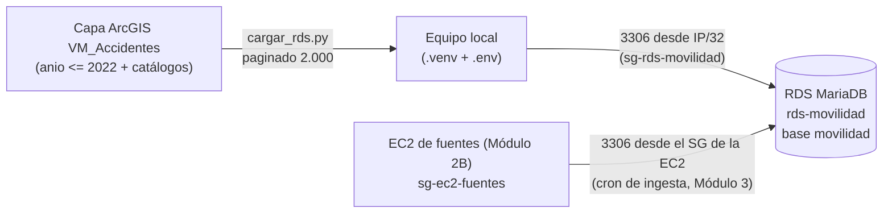
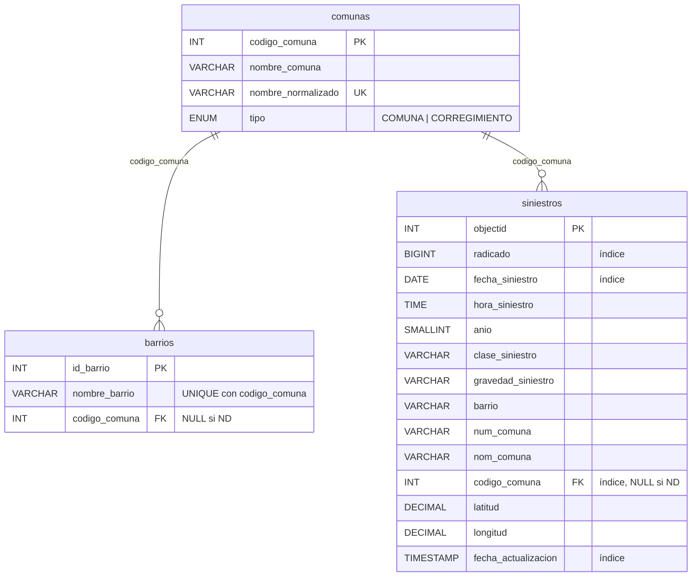

# Punto 2 — Fuentes de datos

## Objetivo

Simular datos en RDS MariaDB, archivos en una instancia de EC2 y URLs en Internet.

_Fuente: [docs/enunciado.md](../docs/enunciado.md)._

## Organización de la carpeta

- `rds/`: RDS MariaDB (siniestros 2019–2022 y catálogos de comunas y barrios).
- `ec2/`: archivos en la instancia EC2 (población y festivos). _Pendiente: Módulo 2B._
- `url/`: URLs en Internet (capa ArcGIS 2023–2025 y Open-Meteo).

Las decisiones del caso (corte 2019–2022 / 2023–2025, llave `codigo_comuna`, normalización de nombres) están en [CLAUDE.md, sección 9](../CLAUDE.md).

---

## Fuente a) RDS MariaDB — base `movilidad`

### Arquitectura



| Recurso | Configuración |
|---------|---------------|
| Instancia | `rds-movilidad`: MariaDB (versión por defecto vigente), `db.t3.micro`, 20 GB `gp2`, single-AZ, accesible públicamente, sin backups (`--backup-retention-period 0`), sin Enhanced Monitoring ni Performance Insights |
| Base / usuario | Base inicial `movilidad`, usuario `admin_movilidad`, clave aleatoria de 24 caracteres guardada solo en `.env` (`RDS_CLAVE`) |
| Red | VPC por defecto. `sg-rds-movilidad` permite el puerto 3306 desde la IP pública del desarrollador (`/32`, marcada con la descripción `ip-desarrollador`) y desde el security group `sg-ec2-fuentes` |
| `sg-ec2-fuentes` | Se crea vacío aquí para poder referenciarlo; la EC2 del Módulo 2B lo usará |

**¿Por qué pública?** Para cargar y consultar la base desde el equipo local sin túneles. El acceso queda restringido a una sola IP (`/32`) y al security group de la EC2.

### Modelo de datos ([esquema.sql](rds/esquema.sql))



- Todas las tablas usan `utf8mb4`. `barrios.nombre_barrio` usa la collation `utf8mb4_bin` para conservar el texto exacto de la fuente (con `unicode_ci`, "Belén" y "Belen" chocarían en el índice único).
- `siniestros.fecha_actualizacion` se llena sola y cambia **solo si cambia algún valor** de la fila al recargar. Sirve para la ingesta incremental del Módulo 3.
- `siniestros` conserva las columnas originales de la capa. `codigo_comuna` es la única derivada: `Comuna 16` → 16, `Corregimiento 90` → 90, y `ND`, `SN01`, `SN02` o vacío → NULL.
- `comunas.nombre_normalizado` está en mayúsculas, sin tildes y sin el prefijo "Corregimiento de" (por ejemplo `SAN CRISTOBAL`, `BELEN`). Es la llave para cruzar con la población.

### Scripts

| Archivo | Qué hace |
|---------|----------|
| [rds/crear_rds.sh](rds/crear_rds.sh) | Detecta la IP pública, crea los dos security groups y sus reglas, crea la instancia RDS, espera a que esté disponible y escribe en `.env` `RDS_HOST`, `RDS_USUARIO`, `RDS_CLAVE`, `ID_SG_RDS` e `ID_SG_EC2`. Es idempotente: si la instancia está detenida la inicia, y si `.env` perdió la clave asigna una nueva. Si AWS rechaza `db.t3.micro`, muestra el error y la posible causa |
| [rds/actualizar_mi_ip.sh](rds/actualizar_mi_ip.sh) | Cuando se cambia de red, reemplaza la regla `ip-desarrollador` anterior por la IP actual: puerto 3306 en `sg-rds-movilidad` y puerto 22 en `sg-ec2-fuentes` (este último solo si ya existía una regla) |
| [rds/esquema.sql](rds/esquema.sql) | Tablas `comunas`, `barrios` y `siniestros` con llaves foráneas e índices (`CREATE TABLE IF NOT EXISTS`) |
| [rds/cargar_rds.py](rds/cargar_rds.py) | Aplica el esquema y carga los catálogos (consultas agregadas a la capa, todos los años). Descarga los siniestros con `anio <= 2022` paginando de 2.000 en 2.000, guarda una copia en `datos_locales/siniestros_2019_2022.csv`, transforma los tipos y carga en lotes de 1.000 con `INSERT … ON DUPLICATE KEY UPDATE`. Termina con un reporte de verificación |
| [rds/consultas_verificacion.sql](rds/consultas_verificacion.sql) | 5 consultas de evidencia: conteo por año, top comunas, gravedad, join siniestros–comunas y muestra de 10 filas |
| [../infra/pausar_fuentes.sh](../infra/pausar_fuentes.sh) / [reanudar_fuentes.sh](../infra/reanudar_fuentes.sh) | Detienen o inician la RDS (y la EC2 de 2B si está en `.env`) |
| [../infra/destruir_fuentes.sh](../infra/destruir_fuentes.sh) | Borra la RDS sin snapshot, termina la EC2 y borra ambos security groups. Pide escribir `DESTRUIR` y luego limpia esos valores de `.env` |

### Cómo reproducir

Requisitos: AWS CLI v2 con credenciales vigentes del Learner Lab, Bash (Git Bash en Windows), `curl`, `openssl` y Python 3.11+. Todo se ejecuta desde la raíz del repositorio.

1. **Verificar el entorno y preparar Python**

   ```bash
   bash infra/verificar_entorno.sh
   python -m venv .venv
   source .venv/Scripts/activate      # Linux/macOS: source .venv/bin/activate
   pip install -r requirements.txt
   ```

2. **Crear la instancia RDS** (tarda entre 10 y 15 minutos)

   ```bash
   bash punto2_fuentes/rds/crear_rds.sh
   ```

   Al terminar, `.env` contiene `RDS_HOST`, `RDS_PUERTO`, `RDS_USUARIO`, `RDS_CLAVE`, `RDS_BASE`, `ID_SG_RDS` e `ID_SG_EC2`. Si `.env` no existía, se crea a partir de `.env.example`.

3. **Cargar los datos** (la descarga de 157.603 registros tomó unos 33 minutos en la prueba: 79 páginas de unos 25 s cada una, porque la capa responde lento)

   ```bash
   python punto2_fuentes/rds/cargar_rds.py
   ```

   Opciones útiles:
   - `--solo-descarga`: descarga, transforma y reporta **sin** conectarse a la base. Sirve para probar sin AWS.
   - `--usar-csv-local`: reutiliza `datos_locales/siniestros_2019_2022.csv` en vez de descargar otra vez (por ejemplo, para recargar la base después de recrearla).

   La carga es idempotente: volver a ejecutarla no duplica filas.

4. **Verificar el reporte final.** En la consola deben aparecer:
   - Filas por tabla: `comunas` = 21, `barrios` = 444, `siniestros` = 157.603.
   - Filas por año, comparadas contra la capa en vivo y contra la referencia del Módulo 1: 2019 = 46.551, 2020 = 31.755, 2021 = 40.655 y 2022 = 38.642. Como la capa se sigue validando, puede haber diferencias con la referencia. El script indica si el conteo coincide con la capa actual.
   - Radicados duplicados (0 en la prueba) y siniestros con `codigo_comuna` NULL (234 en la prueba).

   **Resultado de la prueba local** (`--solo-descarga`, 2026-11-18, sin AWS): 21 comunas, 444 combinaciones barrio–comuna (se omitió un grupo con barrio vacío) y 157.603 siniestros. Los conteos por año coinciden exactamente con la capa y con la referencia del Módulo 1. No hubo fechas ni horas inválidas y hubo 0 radicados duplicados. Quedaron 234 siniestros con `codigo_comuna` NULL: son los registros de 2019–2022 con comuna ND, SN01, SN02 o vacía, de los 473 que tiene toda la capa.

5. **Ejecutar las consultas de evidencia** con cualquier cliente MariaDB/MySQL (DBeaver, MySQL Workbench o la CLI). Los datos de conexión están en `.env`:

   ```bash
   set -a; source .env; set +a      # carga RDS_HOST, RDS_USUARIO, etc. en la terminal
   mysql -h "$RDS_HOST" -P "$RDS_PUERTO" -u "$RDS_USUARIO" -p "$RDS_BASE" < punto2_fuentes/rds/consultas_verificacion.sql
   ```

   El cliente pide la clave: es el valor de `RDS_CLAVE` en `.env`.

6. **Al cambiar de red** (casa, universidad, datos móviles):

   ```bash
   bash punto2_fuentes/rds/actualizar_mi_ip.sh
   ```

7. **Al terminar la sesión** (ahorra crédito):

   ```bash
   bash infra/pausar_fuentes.sh        # en la siguiente sesión: bash infra/reanudar_fuentes.sh
   ```

   Para eliminar todo: `bash infra/destruir_fuentes.sh`.

### Evidencias

Pantallazos sugeridos (guardar en [docs/evidencias/](../docs/evidencias/)):

| Archivo sugerido | Contenido |
|------------------|-----------|
| `p2_rds_01_crear_rds.png` | Consola con el resumen final de `crear_rds.sh` (sin mostrar la clave) |
| `p2_rds_02_consola_rds.png` | Consola de AWS → RDS → `rds-movilidad` en estado *Available* (motor, clase, endpoint) |
| `p2_rds_03_security_group.png` | Reglas de entrada de `sg-rds-movilidad` (3306 desde IP/32 y desde `sg-ec2-fuentes`) |
| `p2_rds_04_cargar_rds.png` | Reporte final de `cargar_rds.py` (filas por tabla, por año, duplicados y NULL) |
| `p2_rds_05_conteo_por_anio.png` | Resultado de la consulta 1 de `consultas_verificacion.sql` |
| `p2_rds_06_join_comunas.png` | Resultado de la consulta 4 (join siniestros–comunas) |
| `p2_rds_07_muestra.png` | Resultado de la consulta 5 (muestra de 10 filas) |

---

## Fuente b) Archivos en EC2

_Pendiente: Módulo 2B._

## Fuente c) URLs en Internet

_Pendiente: se documenta junto con la ingesta por Lambda (Módulo 3)._
